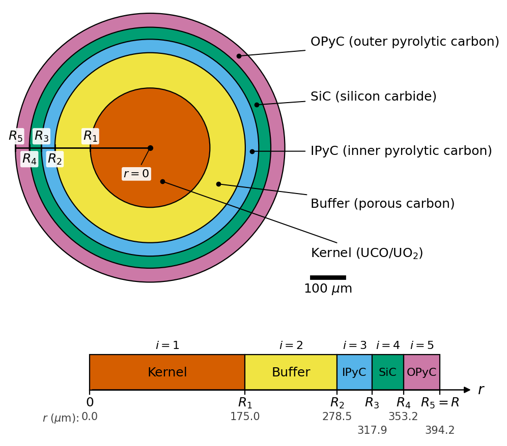

# STRATO: Spherical TRISO Analysis and Transport Operations

STRATO models how fission products (for example silver, caesium and strontium) diffuse out of a single TRISO coated fuel particle. It solves the same multilayer spherical diffusion problem two independent ways: **Method A**, a spherical backward-time centred-space (BTCS) finite-difference scheme written in Rust, and **Method B**, an exact multilayer Sturm-Liouville eigenfunction series. Each method is used to check the other. Version 2.0 replaces the finite-volume solver of version 1.x by the BTCS scheme and is verified numerically on synthetic cases. Generation, radioactive decay and temperature-dependent diffusivity are not part of the solver yet.

> **Synthetic inputs.** The only bundled input, `inputs/synthetic/synthetic_five_layer.toml`, uses synthetic radii and diffusivities chosen for verification. They are not measured TRISO properties, and no result from this case is a prediction of real fission-product release.

> **Numerical verification is not experimental validation.** Every agreement reported in this repository between the two methods, or between a method and a closed-form or independently computed reference, shows that the stated equations are solved correctly. It does not show that the physics or the inputs are right, and none of it is a comparison with measurements.

<p align="center">
  
</p>

The five layers of a TRISO particle and their outer radii $R_1$ to $R_5$. The figure is drawn to average AGR-1 Baseline dimensions (source in `docs/archive/finite-volume/v1.0.0/figures/v1_0_0_triso_cross_section.py`); the synthetic example uses different radii.

## Status

**Version 2.1.0.** The solver is the BTCS scheme of `docs/mathematics/btcs/`. The baseline scope (Documents 0 to 4) is constant temperature, constant diffusivity in each layer, initial inventory in the kernel, perfect interface contact and an absorbing outer surface. Version 2.1.0 adds fission-product generation, radioactive decay and temperature-dependent diffusivity to the solver (Document 5), a scenario engine for the five operating scenarios, the extensions of the Sturm-Liouville series for decay and a kernel source (Document 6), the data registers with the experimental release curves, the comparison program and the shared results of `data/results/`. The live simulation of the website still runs the baseline scope; it is wired to the new solver in the following change. See [Development status](#development-status).

**What is verified.** The scheme as specified is proved conservative in exact arithmetic and positivity-preserving at every time step (Documents 1 and 2, reviewed independently). In floating point the code reports the balance residual together with an a-posteriori rounding bound, and the production tridiagonal solve is coded in the form for which the positivity proof holds. On the synthetic cases the observed order of the release fraction is 2 in space and about 1 in time. The release fraction is compared with the Sturm-Liouville series, with the closed series of the homogeneous sphere, and with a value computed by a separate-language reference (see [Verification](#verification)). These are numerical checks of the stated model. No result of this repository is validated against measurements.

## Web demonstration

**Live: https://weewzr.github.io/STRATO/**

The Explore page runs in five blocks from one shared selection: the governing equation with its physics controls (baseline diffusion, generation, decay, temperature-dependent diffusion, combined), the operating-scenario row, the Numerical Interpretation (fourteen expandable items that follow the selection), the live simulation with the particle view and the numerical controls, and the results. Which choices are implemented, verified or planned is read from what the WebAssembly wrapper of the running build reports about itself, so a later wrapper enables them without a change of the page. For a selection that the build does not compute, the page shows the equation and the explanations, and the simulation and results say why they show nothing; no other model is run in its place. The simulation is computed in the browser by the Rust BTCS solver compiled to WebAssembly (results are labelled `COMPUTED v2.0`); no equation is re-implemented in JavaScript. The page offers exactly two methods, Method A (BTCS) and Method B (Sturm-Liouville). Every page keeps to minimal text: equations, controls, graphs and results come first, and the assumptions, limitations, derivations, verification methodology and build details are on the last page of the navigation, Scientific Documentation. Compare and Validate show the experimental-comparison graph, with its R² label, caption and citation, only where the build holds a comparison file.

- **Verified:** five-layer spherical diffusion with a constant diffusivity per layer, on the synthetic five-layer case. The live simulation runs that synthetic case and says so; AGR-1 UCO TRISO is shown as the reference fuel by its registered geometry only.
- **Researched, not implemented:** fission-product generation, radioactive decay and temperature-dependent diffusivity. Their equations and explanations can be selected and are labelled with their status; the simulation does not run them.
- **Pending:** every other mechanism of the research catalogue, Materials Studio calculations, and FLiBe and cover-gas transport. Nothing on the page is validated against measurements.

The site also publishes the BTCS documents 0 to 4 and the register documents with the mathematics typeset: https://weewzr.github.io/STRATO/docs/index.html. Build, test and deployment commands: [`web/README.md`](web/README.md).

## Scientific objective

The objective is a transparent and verifiable model of fission-product release from a single TRISO particle. Every equation, numerical method and parameter should be traceable to a derivation or a published source. Version 2.0 provides the verified numerical foundation. Physical inputs from the literature are kept in the parameter register and are not read by the solver.

## Particle geometry

```text
            r = 0                                                     r = R5
  centre -- kernel -- buffer -- IPyC -- SiC -- OPyC -- outer surface (c = 0)
   region   i = 1      i = 2     i = 3   i = 4   i = 5
   outer    R1         R2        R3      R4      R5
```

There are five concentric spherical layers, each with its own constant diffusivity $D_i$ in $\mathrm{m^2\,s^{-1}}$. The radii (in $\mathrm{m}$) and diffusivities are inputs.

The bundled synthetic case uses these values (the field `cells` of the input is the number of grid intervals of the layer):

| Layer $i$ | Name | Outer radius $R_i$ | Diffusivity $D_i$ | Grid intervals |
|---|---|---|---|---|
| 1 | Kernel | $2.0\times10^{-4}\ \mathrm{m}$ | $1.0\times10^{-12}\ \mathrm{m^2\,s^{-1}}$ | 40 |
| 2 | Buffer | $3.0\times10^{-4}\ \mathrm{m}$ | $4.0\times10^{-10}\ \mathrm{m^2\,s^{-1}}$ | 40 |
| 3 | IPyC | $3.5\times10^{-4}\ \mathrm{m}$ | $8.0\times10^{-13}\ \mathrm{m^2\,s^{-1}}$ | 40 |
| 4 | SiC | $4.0\times10^{-4}\ \mathrm{m}$ | $2.0\times10^{-14}\ \mathrm{m^2\,s^{-1}}$ | 40 |
| 5 | OPyC | $4.5\times10^{-4}\ \mathrm{m}$ | $7.0\times10^{-13}\ \mathrm{m^2\,s^{-1}}$ | 40 |

The initial kernel concentration is $C_\mathrm{init} = 1.0\ \mathrm{mol\,m^{-3}}$, the time step is $\Delta t = 200\ \mathrm{s}$ and the end time is $2\times10^5\ \mathrm{s}$. The input records a temperature of $1000\ \mathrm{K}$, which the solver does not use in the calculation.

## Mathematical model

Inside layer $i$ the concentration $C(r,t)$ in $\mathrm{mol\,m^{-3}}$ obeys spherical diffusion:

$$\frac{\partial C}{\partial t} = \frac{1}{r^2}\frac{\partial}{\partial r}\left(r^2 D_i \frac{\partial C}{\partial r}\right), \qquad R_{i-1} < r < R_i ,$$

with $R_0 = 0$.

| Assumption | Treatment |
|---|---|
| Centre | Symmetry, $\partial C/\partial r = 0$ at $r = 0$ |
| Interfaces | Perfect contact: $C$ and the flux $D\,\partial C/\partial r$ are continuous |
| Outer surface | Absorbing, $C(R_5, t) = 0$ |
| Initial state | Uniform $C_\mathrm{init}$ in the kernel, zero elsewhere |
| Temperature | Constant; the input value is recorded only |
| Decay, generation | Not included |

The release fraction is

$$F(t) = \frac{M_\mathrm{rel}(t)}{M_0},$$

the share of the initial inventory $M_0$ (in $\mathrm{mol}$) that has left through the outer surface by time $t$.

### Method A: BTCS finite-difference solver

`src/numerical/btcs.rs` and its modules (`grid`, `interfaces`, `boundary_conditions`, `coefficients`, `tridiagonal`, `inventory`, `diagnostics`) implement the final formulation of Document 2 (equations F1 onward):

- the unknowns are nodal concentrations $C_i^j$ at the radii $r_i$ of a grid with a uniform spacing inside each layer and a node on each of the four material interfaces;
- the time derivative is a backward difference, so each step solves one tridiagonal system for the new nodal values; the production solve is the elimination coded in the form of Document 2 (F24);
- the four interface rows enforce continuity of $C$ and of the flux, the centre row uses the symmetric limit, and the outer node is fixed at zero;
- the discrete inventory, the release rate and the cumulative release are accounted so that the balance residual can be reported at every step, together with its a-posteriori rounding bound.

The solver accepts the existing TOML input; the temporal and spatial orders are observed, not assumed, and the documents say which properties are proved, outlined, observed or open.

### Method B: Sturm-Liouville series

`src/analytical/sturm_liouville.rs` uses the multilayer Sturm-Liouville eigenfunction expansion. It writes $u = rc$ in each layer and propagates $u$ and the flux through the layers. Eigenvalues are isolated by a Sturm count and refined by bisection. The release is the series

$$F(t) = 1 - \sum_n w_n e^{-\Lambda_n t},$$

with modal weights $w_n$ and decay rates $\Lambda_n$ in $\mathrm{s^{-1}}$. The code reports how many modes it used, the time from which the series is valid, and its round-off accuracy floor. `src/analytical/homogeneous_sphere.rs` holds the closed series of the homogeneous sphere that the regression checks use.

### Derivations

The derivation of Method A is in five documents under [`docs/mathematics/btcs/`](docs/mathematics/btcs/): [Document 0](docs/mathematics/btcs/00_original_documents.md) (account and algebra check of the original documents), [Document 1](docs/mathematics/btcs/01_from_ftcs_to_five_layer_btcs.md) (the derivation), [Document 2](docs/mathematics/btcs/02_final_formulation.md) (the final formulation, normative), [Document 3](docs/mathematics/btcs/03_rust_pseudocode.md) (Rust pseudocode) and [Document 4](docs/mathematics/btcs/04_equation_to_code_traceability.md) (every equation traced to its pseudocode, its Rust item and its test). The finite-volume derivation documents of version 1.x are archived in [`docs/archive/finite-volume/`](docs/archive/finite-volume/README.md) with a note on where the removed code is kept.

## Installation

Install a stable Rust toolchain (https://rustup.rs), then build:

```bash
git clone https://github.com/weewzr/STRATO.git
cd STRATO
cargo build --release
```

Dependency versions are pinned in `Cargo.lock`.

## Running

```bash
cargo run --release --bin strato-btcs -- inputs/synthetic/synthetic_five_layer.toml
```

Options: `--out DIR` (output folder, default the `[output] directory` of the input), `--snapshots T1,T2,...` (times in seconds at which concentration profiles are written; each is served from the nearest step), `--commit HASH`, `--parameter-source TEXT` and `--parameter-class TEXT` (the source row and class that the exported parameters carry), `--max-nodes N` and `--max-steps N`.

To run your own case, copy `inputs/literature/literature_inputs.template.toml` and fill in every `INSERT_VALUE_HERE`. The program refuses to run while any placeholder is left, and lists each one.

## Outputs

Files are written to the output folder (`results/synthetic-five-layer/` for the bundled case). Each carries a provenance header (solver version, commit, input digest, parameter source and class), and the column headers carry the full physical name with its unit.

| File | Content |
|---|---|
| `btcs_timeseries.csv` | time (s), inventory (mol), cumulative release (mol), release fraction, release rate (mol/s), balance residual (mol) with its derived bound, concentration range (mol/m³) |
| `btcs_profiles.csv` | concentration (mol/m³) at every node, with its radius (m), node class and material, at the requested snapshot times |
| `btcs_run.json` | everything above plus the grid, the input, the matrix and series diagnostics |

Standard output gives a `key=value` summary: number of nodes, step, number of steps, final release fraction, final inventory, the worst relative balance residual with the bound of the final step, and the minimum concentration.

## Verification

```bash
cargo test --release
cargo run --release --example btcs_regression -- --commit "$(git rev-parse HEAD)"
```

The first command runs the unit, property, verification and regression tests. The second runs the independent check of every regression case and ends with `BTCS_REGRESSION_CHECK PASS`, failing otherwise. Continuous integration ([`.github/workflows/ci.yml`](.github/workflows/ci.yml)) runs the tests, this check, the synthetic case and a Python reference check of the analytical series on pushes to `main`, on version tags and on pull requests.

| Check | Result (synthetic five-layer case, 40 intervals per layer, $\Delta t = 200\ \mathrm{s}$) |
|---|---|
| Release fraction at $t = 2\times10^5\ \mathrm{s}$ | Method A: $F = 0.4324291$; Method B (series): $F = 0.4325556$ (the difference is the discretisation error of this mesh and step) |
| Observed orders on the three regression cases | 1.999 to 2.000 in space and 0.93 to 1.02 in time, each case against a reference that contains no BTCS code (`tests/golden/btcs/README.md`) |
| Balance residual | worst relative balance residual $6.9\times10^{-12}$; the derived a-posteriori bound of the final step is $1.1\times10^{-8}$ |
| Minimum concentration | exactly 0 (no negative value) |
| Series against a separate-language computation | the series value $F(2\times10^5\ \mathrm{s}) = 0.4325556390930383$ of a 50-digit Python reference agrees with the Rust series to better than $10^{-10}$ |

The regression references in [`tests/golden/btcs/`](tests/golden/btcs/README.md) are the solver's own earlier output: they detect change and are not truth. Each case also carries an independent check against a reference that contains no BTCS code. The mathematics of the error and rounding statements is in Documents 1 and 2.

This is **verification**: it shows that the code solves its equations correctly. Two methods can agree with each other and both still rest on the wrong physics or the wrong inputs. An internal comparison of the five-layer model against experimental release data was conducted at SNRSI. The early release curve agreed within 2%, with increasing deviation at later stages. These results are not yet public, and the public v1.0 release contains numerical verification only. Publication of experimental comparison results is planned for v2.0, with AGR-1 release data as a public-validation objective. See [`docs/development/provenance.md`](docs/development/provenance.md) for the evidence and the claims that remain unverified.

## Development status

| Version | Stage | Scope | Status |
|---|---|---|---|
| v1.0 | Phase 1 (developed June to October 2026) | Multilayer analytical and finite-volume diffusion model | Released (v1.0.0, v1.0.1); the finite-volume solver is retired and archived |
| v2.0 | BTCS solver | Spherical BTCS finite-difference solver (Method A) beside the Sturm-Liouville series (Method B), with the web demonstration | Released (2.0.0) |
| v2.1 | Physics and data | Radioactive decay, fission-product generation, Arrhenius diffusivity and temperature histories in the BTCS scheme; scenarios; Method B extensions; registers with experimental curves; comparison and shared results; WebAssembly interface of ABI 4 | Version 2.1.0 (the website's live simulation is wired in the following change) |
| v3.0 | Future | Partition coefficients, matrix transport, inverse modelling, uncertainty quantification, particle populations | Planned |

## Known limitations of v2.1.0

- The only bundled input of the command line is synthetic, so the public example is not an experimental validation case. Literature parameters are collected in [`data/`](data/reference/README.md) and read by the scenario engine and the results program; no registered dataset supports a whole-curve R² today, so every comparison with a measurement is a plot only.
- In the baseline problem temperature is constant and each layer's diffusivity does not depend on temperature; the stages with temperature-dependent diffusivity evaluate it at the temperature in the middle of each step.
- Generation and decay exist in the stages and scenarios, not in the baseline problem. All inventory starts in the kernel.
- Interfaces are in perfect contact, with no partition coefficients.
- The outer surface is a perfect sink.
- The model covers a single intact particle. Matrix, failed particles and populations are not modelled.
- Backward time stepping is only first order in time, so the time step controls accuracy at early times.
- Method B (the series) is valid for the baseline problem, for decay and a kernel source at a constant temperature through its extensions (only where their drawing mask accepts the value), and never when the temperature changes in time; it applies only from the time its validity rule reports.

## Repository layout

| Path | Content |
|---|---|
| `src/` | Rust library and the `strato-btcs` command line: analytical solver (Method B), BTCS solver (Method A), input handling, property functions, regression and export |
| `tests/`, `examples/` | Unit, property, verification and regression tests, the BTCS regression references (`tests/golden/btcs/`), the analytical series reference (`tests/golden/analytical/`) and the regression check program |
| `inputs/` | Synthetic five-layer case, the regression cases and the literature input template |
| `data/` | Literature parameter register and CSV tables |
| `docs/mathematics/` | BTCS Documents 0 to 4 (`btcs/`), the property functions, and two short notes at the old paths of the archived Phase 2 documents |
| `docs/archive/finite-volume/` | The derivation, design and provenance documents and figures of version 1.x, with a note on where the removed code is |
| `docs/development/` | The frontend audit, the visualisation library comparison, and short notes at the old paths of the archived provenance, review-package and change-plan documents |
| `scripts/` | The Python reference check of the analytical series, the parameter-register tool and the register helpers (versions pinned in `requirements.lock.txt`) |
| `web/` | Web demonstration (React, TypeScript, KaTeX, Plotly, three.js); see [`web/README.md`](web/README.md) |
| `crates/` | WebAssembly wrapper of the solver (`strato-wasm`) and the tools workspace (`Cargo.toml`, with `strato-docsite`, which renders the documents into the site, `strato-webtools`, which generates the web data files and runs the catalogue and wasm build checks, and `strato-data`, the checks of the register files) |
| `prompt/` | Instruction package for the web demo |

## Documentation

| Topic | Location |
|---|---|
| BTCS Documents 0 to 4 (derivation, final formulation, pseudocode, traceability) | [`docs/mathematics/btcs/`](docs/mathematics/btcs/) |
| Documents of version 1.x, archived (derivations, Phase 2 design documents and their PDFs, provenance of the v1.0 results, review package, v1.0 to v2.0 change plan) | [`docs/archive/finite-volume/`](docs/archive/finite-volume/README.md) |
| Contribution rules | [`CONTRIBUTING.md`](CONTRIBUTING.md) |
| Version history | [`CHANGELOG.md`](CHANGELOG.md) |

## Key references

- Gelbard, F. (2003). *Analytical modeling of fission product releases by diffusion from multicoated fuel particles* (SAND2002-3966). Sandia National Laboratories.
- International Atomic Energy Agency. (1997). *Fuel performance and fission product behaviour in gas cooled reactors* (IAEA-TECDOC-978). IAEA.
- Hales, J. D., Jiang, W., Toptan, A., & Gamble, K. A. (2021). Modeling fission product diffusion in TRISO fuel particles with BISON. *Journal of Nuclear Materials, 548*, 152840. https://doi.org/10.1016/j.jnucmat.2021.152840

## Citation

If you use STRATO, please cite it with the metadata in [`CITATION.cff`](CITATION.cff) (version 2.1.0).

## Licence

The `LICENSE` file on `main` is the GNU Affero General Public License, version 3, and `Cargo.toml` and `CITATION.cff` declare `AGPL-3.0-only`. See [`LICENSE`](LICENSE).

Releases v1.0.0 and v1.0.1 were published under the MIT licence (the `LICENSE` file at both tags) and remain available under it. The change to AGPL-3.0-only was made after v1.0.1 to match the licence of the [Outram Park](https://github.com/theodoreOnzGit/outram-park-backend) project, whose interface the planned STRATO web demo builds on.
