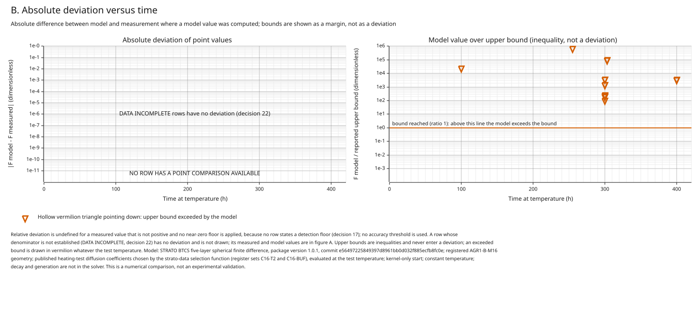
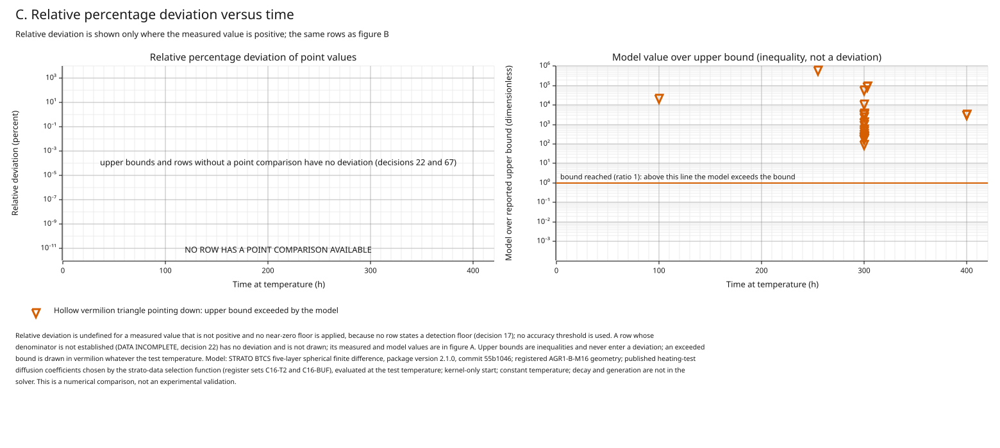
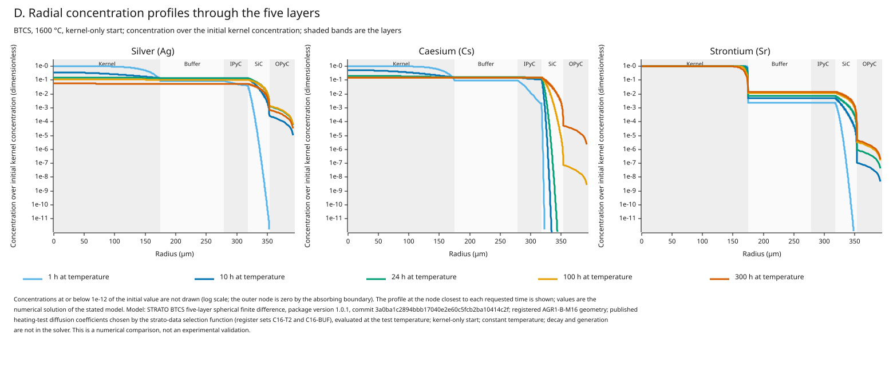
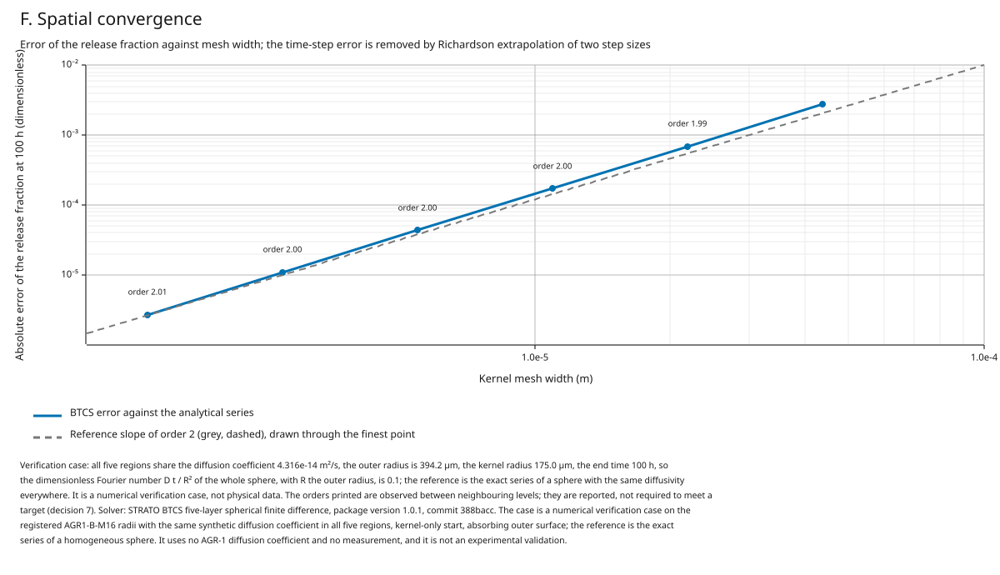
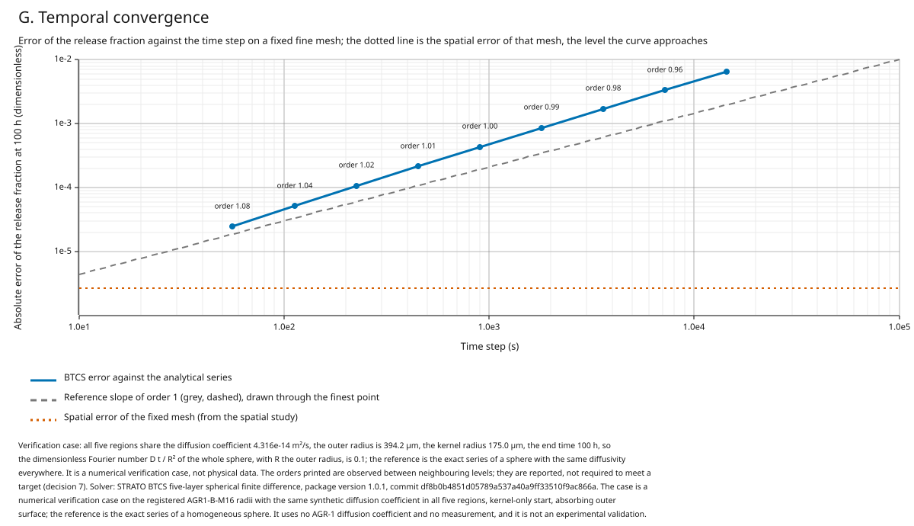
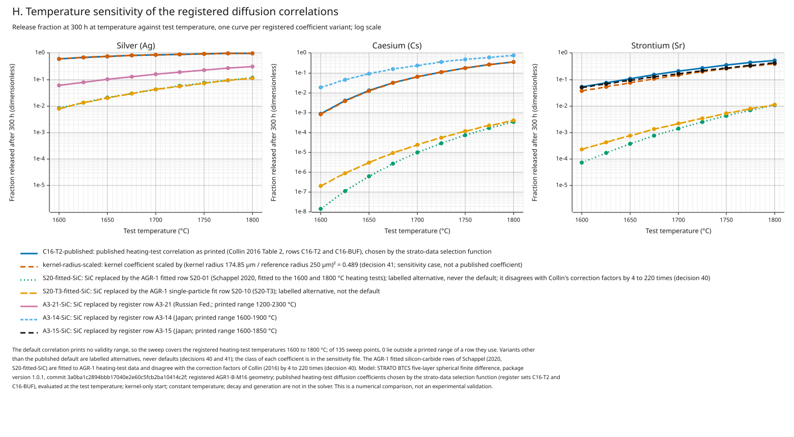
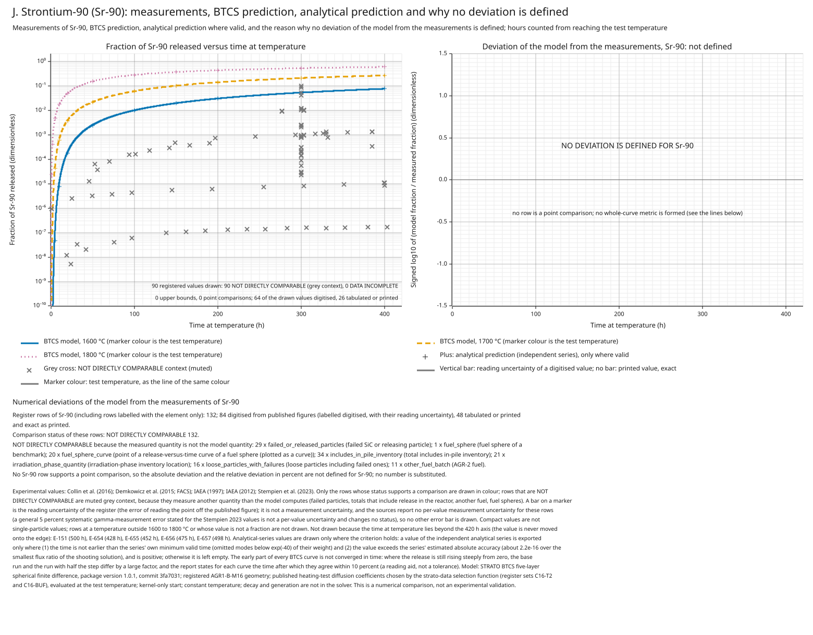
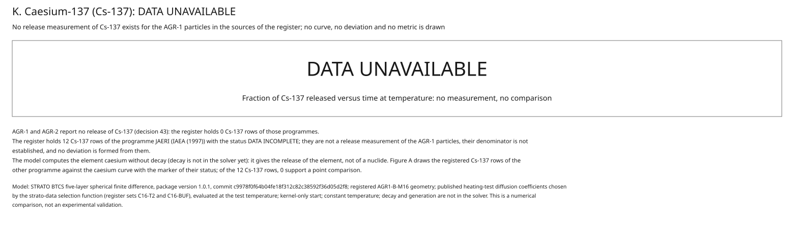

# Experimental Comparison: Data Interpretation and Limitations

STRATO simulates how a fission product moves through one ideal TRISO particle: a kernel and four coating layers (buffer, inner pyrocarbon, silicon carbide, outer pyrocarbon) in perfect contact, with every atom starting in the kernel. The AGR-1 experiments did not measure single particles. Almost every AGR-1 value is for a compact, a small cylinder that holds 4145 particles in a graphite matrix; one particle holds about 2.4 in 10,000 (2.4e-4) of a compact.

Some measurements are only upper bounds, written with "<". They say that the release was at most that large, and this report treats them as inequalities, never as measured values. Many values (219 of the 482 rows) were read from published figures, so they carry the reading uncertainty of the register; the others are printed in tables or in the text. None of the rows that were compared carries a per-value measurement uncertainty published by its source (the one general statement in the register, a 5 percent systematic gamma-measurement error plus counting statistics for the Stempien 2023 values, is not a per-value uncertainty and changes no status). This report does not make one up: where an uncertainty is missing, it says so, and no error bar is drawn.

Real release also depends on things this model does not contain: what the fuel went through in the reactor before the heating test (the irradiation history and the inventory profile at its end), silver and other products that were already outside the SiC layer before the test, transport through the graphite matrix, particles with broken coating layers, and the temperature ramps of the real tests. For silver, strontium and europium, the register cites published work that attributes most of the release to the time in the reactor. For those, most compact values do not describe diffusion out of an intact particle during the test, and this report marks them NOT DIRECTLY COMPARABLE.

The comparisons here are meant to show how the model's release behaves and how far it is from the data. They quantify deviations; they do not by themselves establish a direct single-particle validation. A comparison, even a close one, would not validate the model on single particles. A large deviation stays visible. The accuracy of the solver itself (its numerical verification) is a separate question and is shown in the sections on verification below. Nothing in this report calls the model validated.

## Summary of the result

Every one of the 482 rows of the release register has a status that the program derives from the row and from the coordinator's decisions (decisions 15 to 24 of the project's decision list). The counts are:

| Status | Rows |
|---|---:|
| NOT ASSESSED | 22 |
| DATA INCOMPLETE | 50 |
| NOT DIRECTLY COMPARABLE | 393 |
| COMPARISON AVAILABLE | 0 |
| WITHIN REPORTED UNCERTAINTY | 0 |
| OUTSIDE REPORTED UNCERTAINTY | 0 |
| WITHIN REPORTED UPPER BOUND | 0 |
| EXCEEDS REPORTED UPPER BOUND | 17 |

- **Upper bounds.** 17 rows are read as inequalities (reported bounds of caesium, and caesium compact totals read as bounds, decision 19). The model satisfies 0 of them and exceeds 17. Where it exceeds, the model release is between 9.04e1 and 5.91e5 times the bound (smallest and largest ratio). These exceedances are shown in the tables and figures; none is hidden.
- **These rows are not independent observations.** The 17 rows report 10 distinct results (one result is one compact or one group of compacts, at one test temperature and one time at temperature). Where several rows give the same result, they are the same compact result printed in more than one place in the sources, for example in a figure of one paper and in a table of another, or restated as a bound in the text; they are listed as equal here: E-015 = E-187; E-016 = E-193; E-017 = E-198; E-018 = E-032 = E-199; E-019 = E-201; E-021 = E-195. A count of rows is therefore not a count of independent measurements, and the number of rows that the model exceeds is not the number of independent results that it exceeds.
- **Point comparisons.** 0 rows have the status COMPARISON AVAILABLE as a point value. The only rows that were intended as point values (the matrix-corrected fractions of intact compacts of Cs-134 and Ag-110m, figures 3 and 6 of the source) have a denominator that the register records as *not established*, so by decision 22 they stay DATA INCOMPLETE. For these rows only the measured value, the model value and the log10 ratio of the two are given, for scale; no deviation, relative deviation, RMSE, MAE or maximum is formed for them, and they enter no status and no aggregate.
- **Sr-90.** No row of Sr-90 supports a comparison: the intact-compact values are totals that include inventory released in the reactor, and the other rows are failed-particle quantities. The Sr-90 panel of figure A and figure J show the Sr-90 fractions inside their time axis as muted grey crosses (context), never as a comparison; rows whose time lies beyond the axis are not drawn and are listed in the footer of the figure.
- **Model limitations of every result.** kernel-only start (inventory-matched start node); constant diffusion coefficient per layer evaluated at the test temperature from the first hour (heating ramps are not modelled); no radioactive decay and no fission-product generation in the solver yet; perfect interface contact; absorbing outer surface; one intact particle, no matrix; the model fraction is a fraction of the particle's own inventory.
- **Status of the model.** Nothing here validates the model. The solver is numerically verified elsewhere; this report compares its release behaviour with the data and shows where they differ.

## What was run

The solver is the five-layer spherical backward-time centred-space finite-difference solver of the STRATO repository (package version 1.0.1, source commit `c9978f0f64b04fe18f312c82c38592f36d05d2f8`). For every comparable row the program runs it for the registered measured baseline geometry (design `AGR1-B-M16`), with each layer's diffusion coefficient evaluated at the test temperature from the registered published heating-test correlation, chosen by the selection function of the `strato-data` crate (decisions 16, 39, 40 and 47: the rows of set `C16-T2` for kernel, pyrocarbon and silicon carbide, set `C16-BUF` for the buffer), and reads the release fraction at the time of the measurement. The time is counted from the moment the test temperature is reached. The temperature ramp of the real test (about 31 to 35 h) is not modelled, and the diffusion coefficients are constant, because the solver has constant coefficients; temperature-dependent diffusion, decay and generation are not yet in the solver.

Outer radii (µm) of kernel, buffer, IPyC, SiC and OPyC: 175.0, 278.5, 317.9, 353.2, 394.2 (register rows G-01, G-02, G-03, G-04, G-05). The kernel diameter of the register is 350 µm (the measured value of the kernel batch is 349.7 µm; the kernel-radius sensitivity case of decision 41 uses the kernel radius of 174.85 µm of the selection function, half the measured kernel diameter of 349.7 µm, so its factor is (174.85/250)^2 = 0.489; the mesh of every run uses the register's 175.0 µm).

Coefficient sets used by default:

- Ag - published heating-test correlation as printed (Collin 2016 Table 2, rows C16-T2 and C16-BUF), chosen by the strato-data selection function: kernel: C16-01; buffer: C16-22; IPyC: C16-02; SiC: C16-03; OPyC: C16-02. Class of each coefficient (owner ruling 16) and phase of use: kernel: published PARFUME correlation, phase heating test; buffer: published PARFUME correlation, phase heating test; IPyC: published PARFUME correlation, phase heating test; SiC: published PARFUME correlation, phase heating test; OPyC: published PARFUME correlation, phase heating test. Statements of the selection function: kernel: UO2 coefficient used for the UCO kernel; no UCO measurement exists; kernel: referred to a 250 µm kernel radius and applied unscaled, as the published AGR-1 modelling does; buffer: modelling convention: the buffer is taken as non-retentive; IPyC: one pyrocarbon set for the inner and the outer pyrocarbon (register GAP-02); SiC: the published correlation over-estimates the silver release of AGR-1 (factor about 1000 at 1600 to 1700 °C and 100 at 1800 °C, Collin 2016); OPyC: one pyrocarbon set for the inner and the outer pyrocarbon (register GAP-02)
- Cs - published heating-test correlation as printed (Collin 2016 Table 2, rows C16-T2 and C16-BUF), chosen by the strato-data selection function: kernel: C16-05+C16-06; buffer: C16-22; IPyC: C16-07; SiC: C16-08+C16-09; OPyC: C16-07. Class of each coefficient (owner ruling 16) and phase of use: kernel: published PARFUME correlation, phase heating test; buffer: published PARFUME correlation, phase heating test; IPyC: published PARFUME correlation, phase heating test; SiC: published PARFUME correlation, phase heating test; OPyC: published PARFUME correlation, phase heating test. Statements of the selection function: kernel: UO2 coefficient used for the UCO kernel; no UCO measurement exists; kernel: referred to a 250 µm kernel radius and applied unscaled, as the published AGR-1 modelling does; buffer: modelling convention: the buffer is taken as non-retentive; IPyC: one pyrocarbon set for the inner and the outer pyrocarbon (register GAP-02); SiC: fluence factor not applied; correlation form under source review; OPyC: one pyrocarbon set for the inner and the outer pyrocarbon (register GAP-02)
- Sr - published heating-test correlation as printed (Collin 2016 Table 2, rows C16-T2 and C16-BUF), chosen by the strato-data selection function: kernel: C16-11; buffer: C16-22; IPyC: C16-12; SiC: C16-13+C16-14; OPyC: C16-12. Class of each coefficient (owner ruling 16) and phase of use: kernel: published PARFUME correlation, phase heating test; buffer: published PARFUME correlation, phase heating test; IPyC: published PARFUME correlation, phase heating test; SiC: published PARFUME correlation, phase heating test; OPyC: published PARFUME correlation, phase heating test. Statements of the selection function: kernel: UO2 coefficient used for the UCO kernel; no UCO measurement exists; kernel: referred to a 250 µm kernel radius and applied unscaled, as the published AGR-1 modelling does; buffer: modelling convention: the buffer is taken as non-retentive; IPyC: one pyrocarbon set for the inner and the outer pyrocarbon (register GAP-02); OPyC: one pyrocarbon set for the inner and the outer pyrocarbon (register GAP-02)

The class (owner ruling 16) and the phase of use of the coefficients of every region are stated in each line above. The kernel values are UO2 surrogates: no UCO kernel measurement exists (decision 40). The coefficient classes and the states of the rows (verified or under source review) are as the register records them at the merged data commit.

Diffusion coefficients (m²/s) at the test temperatures:

| Nuclide | Temperature (°C) | Kernel | Buffer | IPyC | SiC | OPyC |
|---|---:|---:|---:|---:|---:|---:|
| Ag-110m | 1600 | 1.68e-13 | 1.00e-8 | 2.69e-13 | 3.64e-15 | 2.69e-13 |
| Ag-110m | 1700 | 2.87e-13 | 1.00e-8 | 4.44e-13 | 7.32e-15 | 4.44e-13 |
| Ag-110m | 1800 | 4.67e-13 | 1.00e-8 | 6.99e-13 | 1.38e-14 | 6.99e-13 |
| Cs-134 | 1600 | 1.25e-13 | 1.00e-8 | 4.06e-14 | 9.23e-17 | 4.06e-14 |
| Cs-134 | 1700 | 3.00e-13 | 1.00e-8 | 8.37e-14 | 4.23e-16 | 8.37e-14 |
| Cs-134 | 1800 | 6.98e-13 | 1.00e-8 | 1.61e-13 | 1.83e-15 | 1.61e-13 |
| Sr-90 | 1600 | 5.42e-17 | 1.00e-8 | 7.38e-12 | 2.46e-15 | 7.38e-12 |
| Sr-90 | 1700 | 2.65e-16 | 1.00e-8 | 1.40e-11 | 6.56e-15 | 1.40e-11 |
| Sr-90 | 1800 | 1.11e-15 | 1.00e-8 | 2.50e-11 | 2.94e-14 | 2.50e-11 |

Numerical settings of the base runs: intervals per layer [160, 20, 20, 160, 20], requested time step 0.05 h; the numerical difference reported beside every model value is the difference to a run with twice the intervals and half the step. Metrics are those of directive section 13 (absolute deviation, relative percentage deviation, RMSE, MAE, maximum absolute deviation, uncertainty-normalised residual) plus the signed log10 ratio and the log-space RMSE (decision 18). Relative deviation is undefined for a measured value that is not positive, and no near-zero floor is applied because no row states a detection floor (decision 17). No accuracy threshold is used anywhere.

## Status of every row: the rules and the incompatible rows

The rules run in this order and the first that applies decides. A status is never computed from a deviation.

| Rule | Status | Rows | Reason | Register rows |
|---|---|---:|---|---|
| `not_a_release_value` (count, constant or threshold) | NOT ASSESSED | 21 | a count, a one-particle constant or a failure threshold: it gives a denominator or an interpretation, not a release to compare | E-031, E-099..E-116, E-155, E-156 |
| `needs_ramps` (prompt range over the heating ramps) | NOT ASSESSED | 1 | the prompt release covers the heating ramps and the first hours at temperature; the solver has a constant diffusion coefficient, and temperature-dependent diffusion is not yet in the solver | E-030 |
| `irradiation_phase_quantity` (irradiation-phase inventory location) | NOT DIRECTLY COMPARABLE | 86 | measures where the inventory sat after irradiation (capsule balance or deposit in matrix and OPyC), not release during a heating test | E-061, E-098, E-232..E-315 |
| `fuel_sphere` (fuel sphere of a benchmark) | NOT DIRECTLY COMPARABLE | 5 | fuel-sphere value with matrix from a benchmark, approximate text value; not a single-particle quantity | E-150..E-154 |
| `other_fuel_batch` (AGR-2 fuel) | NOT DIRECTLY COMPARABLE | 22 | AGR-2 UCO fuel from another irradiation; the registered geometry and coefficients are those of AGR-1, and the totals include inventory released in pile | E-403..E-424 |
| `failed_or_released_particles` (failed SiC or releasing particle) | NOT DIRECTLY COMPARABLE | 135 | measures compacts in which particles with failed SiC (or a releasing particle) dominate; the model has intact coatings | E-001..E-009, E-022..E-026, E-038..E-045, E-047, E-049, E-050, E-054, E-056..E-059, E-069..E-078, E-080, E-082, E-084..E-087, E-090..E-096, E-158..E-162, E-164, E-166, E-167, E-170, E-173..E-177, E-179, E-181, E-182, E-185, E-188..E-192, E-194, E-196, E-197, E-200, E-203..E-207, E-209, E-211, E-212, E-215, E-218..E-222, E-224, E-226, E-227, E-230, E-435..E-461, E-483..E-492 |
| `mixed_particles` (mixture of failed and intact particles) | NOT DIRECTLY COMPARABLE | 5 | mixes failed and intact particles or several compacts | E-060, E-062, E-079, E-088, E-089 |
| `loose_particles_with_failures` (loose particles including failed ones) | NOT DIRECTLY COMPARABLE | 48 | 75 loose particles of which 5 had failed TRISO layers; the unit is particle equivalents summed over the sample, cup-efficiency scaled, on the clock of the whole heating including the ramp | E-493..E-540 |
| `deposition_cup_history` (deposition-cup collection) | NOT DIRECTLY COMPARABLE | 29 | silver collected on deposition cups over a multi-temperature history; collection efficiency not corrected, a lower bound of release, much of the inventory already left the compact in pile | E-374..E-402 |
| `denominator_not_established` (denominator not established) | DATA INCOMPLETE | 43 | the register does not establish what this fraction is a fraction of (decision 22) | E-010..E-014, E-033..E-037, E-117..E-149 |
| `noble_gas` (krypton) | DATA INCOMPLETE | 7 | krypton: the bounds are limited by background, the heating-test krypton SiC row is under source re-read (decision 45) and noble-gas retention is not assessed | E-097, E-217, E-223, E-225, E-228, E-229, E-231 |
| `includes_in_pile_inventory` (total includes in-pile inventory) | NOT DIRECTLY COMPARABLE | 63 | compact total, not matrix-corrected: includes inventory already outside the SiC before the test; published work attributes most Ag, Eu and Sr release to the irradiation, so the number is not release through intact coatings during the test | E-046, E-048, E-051..E-053, E-055, E-063..E-068, E-081, E-083, E-157, E-163, E-165, E-168, E-169, E-171, E-172, E-178, E-180, E-183, E-184, E-186, E-202, E-208, E-210, E-213, E-214, E-216, E-425..E-434, E-462..E-482 |
| `inequality_reported_bound` (reported upper bound) | EXCEEDS REPORTED UPPER BOUND | 4 | reported upper bound: the model release must not exceed it (decision 23) | E-027..E-029, E-032 |
| `inequality_total_as_bound` (total read as an upper bound) | EXCEEDS REPORTED UPPER BOUND | 13 | caesium compact total (mean particle release plus matrix plus background, all non-negative): read as an upper bound on release through intact coatings, labelled digitised where it is (decision 19) | E-015..E-021, E-187, E-193, E-195, E-198, E-199, E-201 |

## Upper-bound comparisons

Each row is an inequality: the model's release fraction at the end of the test must not exceed the number. "Read as" says how the number came to be a bound: the register states it as a bound, or it is a compact total (mean particle release plus matrix plus background, all non-negative), which for caesium, whose in-pile release is small, is read as an upper bound on release through intact coatings (decision 19; digitised totals are labelled digitised). The model fraction is a fraction of the particle's own inventory; the bound is a fraction of the compact inventory; the two are the same quantity only if the inventory outside the particles is negligible.

| Row | Nuclide | Compact or sample | Test temperature (°C) | Time at test temperature (h) | Bound read as | Bound | Model | Model / bound | Status | Numerical difference of the model | Same result also in rows |
|---|---|---|---:|---:|---|---:|---:|---:|---|---:|---|
| E-015 | Cs-134 | 3-2-2 | 1600 | 300 | digitised total read as an upper bound | 2.79e-7 | 9.04e-4 | 3.24e3 | EXCEEDS REPORTED UPPER BOUND | 1.08e-6 | E-187 |
| E-016 | Cs-134 | 4-3-3 | 1600 | 300 | digitised total read as an upper bound | 6.75e-7 | 9.04e-4 | 1.34e3 | EXCEEDS REPORTED UPPER BOUND | 1.08e-6 | E-193 |
| E-017 | Cs-134 | 5-3-3 | 1600 | 300 | digitised total read as an upper bound | 3.80e-6 | 9.04e-4 | 2.38e2 | EXCEEDS REPORTED UPPER BOUND | 1.08e-6 | E-198 |
| E-018 | Cs-134 | 6-2-1 | 1600 | 300 | digitised total read as an upper bound | 4.76e-6 | 9.04e-4 | 1.90e2 | EXCEEDS REPORTED UPPER BOUND | 1.08e-6 | E-032, E-199 |
| E-019 | Cs-134 | 6-4-3 | 1600 | 400 | digitised total read as an upper bound | 9.43e-7 | 3.03e-3 | 3.21e3 | EXCEEDS REPORTED UPPER BOUND | 1.57e-6 | E-201 |
| E-020 | Cs-134 | 4-4-3 | 1700 | 255 | digitised total read as an upper bound | 8.08e-8 | 4.78e-2 | 5.91e5 | EXCEEDS REPORTED UPPER BOUND | 8.50e-7 | - |
| E-021 | Cs-134 | 4-4-3 | 1700 | 303 | digitised total read as an upper bound | 7.28e-7 | 6.47e-2 | 8.89e4 | EXCEEDS REPORTED UPPER BOUND | 3.58e-7 | E-195 |
| E-027 | Cs-134 | five of eight 1600 °C compacts | 1600 | 300 | reported upper bound | 1.00e-5 | 9.04e-4 | 9.04e1 | EXCEEDS REPORTED UPPER BOUND | 1.08e-6 | - |
| E-028 | Cs | all compacts without failed SiC | 1600 | 300 | reported upper bound | 5.00e-6 | 9.04e-4 | 1.81e2 | EXCEEDS REPORTED UPPER BOUND | 1.08e-6 | - |
| E-029 | Cs | all compacts without failed SiC | 1800 | 100 | reported upper bound | 5.00e-6 | 1.06e-1 | 2.13e4 | EXCEEDS REPORTED UPPER BOUND | 4.13e-6 | - |
| E-032 | Cs-134 | 6-2-1 | 1600 | 300 | reported upper bound | 5.00e-6 | 9.04e-4 | 1.81e2 | EXCEEDS REPORTED UPPER BOUND | 1.08e-6 | E-018, E-199 |
| E-187 | Cs-134 | 3-2-2 | 1600 | 300 | printed total read as an upper bound | 2.79e-7 | 9.04e-4 | 3.24e3 | EXCEEDS REPORTED UPPER BOUND | 1.08e-6 | E-015 |
| E-193 | Cs-134 | 4-3-3 | 1600 | 300 | printed total read as an upper bound | 6.77e-7 | 9.04e-4 | 1.34e3 | EXCEEDS REPORTED UPPER BOUND | 1.08e-6 | E-016 |
| E-195 | Cs-134 | 4-4-3 | 1700 | 303 | printed total read as an upper bound | 7.29e-7 | 6.47e-2 | 8.87e4 | EXCEEDS REPORTED UPPER BOUND | 3.58e-7 | E-021 |
| E-198 | Cs-134 | 5-3-3 | 1600 | 300 | printed total read as an upper bound | 3.80e-6 | 9.04e-4 | 2.38e2 | EXCEEDS REPORTED UPPER BOUND | 1.08e-6 | E-017 |
| E-199 | Cs-134 | 6-2-1 | 1600 | 300 | printed total read as an upper bound | 4.75e-6 | 9.04e-4 | 1.90e2 | EXCEEDS REPORTED UPPER BOUND | 1.08e-6 | E-018, E-032 |
| E-201 | Cs-134 | 6-4-3 | 1600 | 400 | printed total read as an upper bound | 9.41e-7 | 3.03e-3 | 3.22e3 | EXCEEDS REPORTED UPPER BOUND | 1.57e-6 | E-019 |

For rows E-028, E-029, the row is labelled with the element only ("Cs"): it is compared as elemental caesium with the caesium coefficient rows and without decay (decision 21).

## DATA INCOMPLETE rows with a model value, for scale only

The register does not establish what the matrix-corrected fractions of figures 3 and 6 are fractions of (denominator *not established*, decision 22), so the program keeps them DATA INCOMPLETE and forms no deviation for them: a relative deviation, an RMSE, a MAE or a maximum computed against an unknown denominator would not mean anything. Only the measured value, the model's release after the first 24 h at temperature to the end of the test (kernel-only start, assumption of decision 20) and the log10 ratio of the two are given, so that the order of magnitude of the difference can be seen. They enter no status and no aggregate. If a source confirms the denominator, the status changes by editing the one register cell and re-running the program.

| Row | Nuclide | Compact | Test temperature (°C) | Window (h at test temperature) | Measured (digitised) | Model over the same window | log10 (model / measured), for scale |
|---|---|---|---:|---|---:|---:|---:|
| E-010 | Cs-134 | 3-2-2 | 1600 | 24-300 | 8.50e-8 | 9.04e-4 | 4.03 |
| E-011 | Cs-134 | 4-3-3 | 1600 | 24-300 | 3.70e-7 | 9.04e-4 | 3.39 |
| E-012 | Cs-134 | 5-3-3 | 1600 | 24-300 | 1.90e-6 | 9.04e-4 | 2.68 |
| E-013 | Cs-134 | 6-2-1 | 1600 | 24-300 | 1.60e-6 | 9.04e-4 | 2.75 |
| E-014 | Cs-134 | 6-4-3 | 1600 | 24-400 | 1.60e-8 | 3.03e-3 | 5.28 |
| E-033 | Ag-110m | 4-3-3 | 1600 | 24-300 | 1.80e-3 | 5.92e-1 | 2.52 |
| E-034 | Ag-110m | 5-3-3 | 1600 | 24-300 | 2.50e-3 | 5.92e-1 | 2.37 |
| E-035 | Ag-110m | 6-2-1 | 1600 | 24-300 | 6.00e-4 | 5.92e-1 | 2.99 |
| E-036 | Ag-110m | 6-4-3 | 1600 | 24-400 | 1.50e-4 | 7.03e-1 | 3.67 |
| E-037 | Ag-110m | 4-4-3 | 1700 | 24-303 | 2.80e-3 | 7.76e-1 | 2.44 |

## Aggregate metrics per dataset

Aggregates are formed per dataset: the same programme, nuclide, group of particles and quantity definition, never across them. Bounds are counted, not averaged into a deviation. Rows that are DATA INCOMPLETE enter no aggregate. A group with no point comparison has no RMSE, MAE or maximum: they are undefined, not zero.

| Programme | Nuclide | Group | Quantity | Rows | Point comparisons | Bounds (satisfied / exceeded) | Model / bound (smallest, largest) |
|---|---|---|---|---:|---:|---|---|
| AGR-1 | Cs-134 | intact | total compact release fraction | 13 | 0 | 0 / 13 | 1.90e2, 5.91e5 |
| AGR-1 | Cs-134 | intact | cumulative compact release fraction (upper bound) | 1 | 0 | 0 / 1 | 9.04e1, 9.04e1 |
| AGR-1 | Cs | intact | cumulative compact release fraction (upper bound) | 2 | 0 | 0 / 2 | 1.81e2, 2.13e4 |
| AGR-1 | Cs-134 | intact | compact release fraction (upper bound) | 1 | 0 | 0 / 1 | 1.81e2, 1.81e2 |

Datasets with a point comparison (status COMPARISON AVAILABLE): 0.

## Figures

![A. Fraction released versus time at temperature, for the three elements at 1600, 1700 and 1800 °C (the model has no decay, so each panel is the element; the nuclides measured are listed in the panel). Lines: BTCS. Plus signs: the independent analytical series of the five-layer problem (the eigenfunction expansion of the repository), only at the times where it meets its validity criterion (truncation valid, and the value above the series' own estimated accuracy; negative or unresolved values are not drawn). Hollow squares: the model's own value over the 24 h-to-end window of a matrix-corrected measurement, drawn beside it because that measurement is a window release, not cumulative from t = 0. Markers: registered measurements, by what they can support (downward triangle: upper bound, hollow when exceeded by the model; hollow diamond: DATA INCOMPLETE; grey cross: NOT DIRECTLY COMPARABLE context). Log scale; no error bars, because no source reports a per-value measurement uncertainty for the plotted rows. Measurements whose time lies beyond the 420 h axis are not drawn and are listed in the footer. The early part of every curve is not converged in time (see the section on accuracy).](figures/figure_A_release_vs_time.svg)

*A. Fraction released versus time at temperature, for the three elements at 1600, 1700 and 1800 °C (the model has no decay, so each panel is the element; the nuclides measured are listed in the panel). Lines: BTCS. Plus signs: the independent analytical series of the five-layer problem (the eigenfunction expansion of the repository), only at the times where it meets its validity criterion (truncation valid, and the value above the series' own estimated accuracy; negative or unresolved values are not drawn). Hollow squares: the model's own value over the 24 h-to-end window of a matrix-corrected measurement, drawn beside it because that measurement is a window release, not cumulative from t = 0. Markers: registered measurements, by what they can support (downward triangle: upper bound, hollow when exceeded by the model; hollow diamond: DATA INCOMPLETE; grey cross: NOT DIRECTLY COMPARABLE context). Log scale; no error bars, because no source reports a per-value measurement uncertainty for the plotted rows. Measurements whose time lies beyond the 420 h axis are not drawn and are listed in the footer. The early part of every curve is not converged in time (see the section on accuracy).*

*B. Absolute deviation versus time of the point comparisons (none exist, so the panel is empty and says so; DATA INCOMPLETE rows have no deviation) and, beside it, the model over each upper bound (an inequality, not a deviation).*

*C. Relative percentage deviation versus time of the point comparisons (none exist), with the policy for undefined values stated on the figure, and the model over each upper bound.*

*D. Radial concentration profiles through the five layers at selected times, 1600 °C.*

*E. Inventory balance: remaining inventory and cumulative release (Ag-110m at 1800 °C), and the relative balance residual with its derived rounding bound for the three nuclides. Generated inventory and decay loss are not applicable yet: the solver has neither.*

*F. Spatial convergence against the exact series of a homogeneous verification case (synthetic diffusion coefficient, not AGR-1 data).*

*G. Temporal convergence on a fixed fine mesh, same homogeneous verification case.*

*H. Temperature sensitivity of the release after 300 h for each registered coefficient variant.*

![I. Silver-110m (Ag-110m): the registered measurements, marked by what each can support, as in figure A (grey cross: NOT DIRECTLY COMPARABLE context, muted; hollow diamond: DATA INCOMPLETE; downward triangle: upper bound, hollow when exceeded by the model), where a vertical bar on a marker is the reading uncertainty of a digitised value and a marker without a bar is a printed value, exact as printed; the BTCS prediction (lines); the analytical prediction where it is valid (plus signs); hollow squares, the model's value over the window of a matrix-corrected measurement; and, in the right panel, the log10 ratio of the model to the measured value, for scale only where no deviation is defined, with the numerical deviations in the lines under the figure. Measurements whose time lies beyond the time axis are not drawn and are listed in the footer.](figures/figure_I_silver_110m_comparison.svg)

*I. Silver-110m (Ag-110m): the registered measurements, marked by what each can support, as in figure A (grey cross: NOT DIRECTLY COMPARABLE context, muted; hollow diamond: DATA INCOMPLETE; downward triangle: upper bound, hollow when exceeded by the model), where a vertical bar on a marker is the reading uncertainty of a digitised value and a marker without a bar is a printed value, exact as printed; the BTCS prediction (lines); the analytical prediction where it is valid (plus signs); hollow squares, the model's value over the window of a matrix-corrected measurement; and, in the right panel, the log10 ratio of the model to the measured value, for scale only where no deviation is defined, with the numerical deviations in the lines under the figure. Measurements whose time lies beyond the time axis are not drawn and are listed in the footer.*

*J. Strontium-90 (Sr-90): the same layout and markers as figure I.*

*K. Caesium-137 (Cs-137): DATA UNAVAILABLE, no release measurement exists for the AGR-1 particles in the sources of the register.*

The figures are static SVG files drawn in Rust with the `plotters` crate (pure Rust SVG backend; it is used by the verified solver package for its own figures and is not linked into the WebAssembly wrapper). Each figure names its experimental sources, the solver version and the commit.

### Ag-110m, Sr-90 and Cs-137 (decision 24)

Figures I and J show, for silver-110m and strontium-90, the registered measurements (digitised values labelled digitised with the reading uncertainty of the register, tabulated values exact), the BTCS prediction, the independent analytical prediction where it is valid, and the deviations. The numbers beside the curves are repeated here; they are the same text as under the figures.

**Ag-110m**

- Register rows of Ag-110m (including rows labelled with the element only): 175; 119 digitised from published figures (labelled digitised, with their reading uncertainty), 56 tabulated or printed and exact as printed.
- Comparison status of these rows: DATA INCOMPLETE 10; NOT DIRECTLY COMPARABLE 165.
- NOT DIRECTLY COMPARABLE because the measured quantity is not the model quantity: 29 x deposition_cup_history (deposition-cup collection); 52 x failed_or_released_particles (failed SiC or releasing particle); 1 x fuel_sphere (fuel sphere of a benchmark); 32 x includes_in_pile_inventory (total includes in-pile inventory); 22 x irradiation_phase_quantity (irradiation-phase inventory location); 16 x loose_particles_with_failures (loose particles including failed ones); 2 x mixed_particles (mixture of failed and intact particles); 11 x other_fuel_batch (AGR-2 fuel).
- E-033 | 1600 °C | 300 h at temperature | measured 1.800e-3 (digitised) | model 5.919e-1 | signed log10 ratio 2.517e0 for scale only: the denominator is not established (decision 22), so no absolute or relative deviation is formed
- E-034 | 1600 °C | 300 h at temperature | measured 2.500e-3 (digitised) | model 5.919e-1 | signed log10 ratio 2.374e0 for scale only: the denominator is not established (decision 22), so no absolute or relative deviation is formed
- E-035 | 1600 °C | 300 h at temperature | measured 6.000e-4 (digitised) | model 5.919e-1 | signed log10 ratio 2.994e0 for scale only: the denominator is not established (decision 22), so no absolute or relative deviation is formed
- E-036 | 1600 °C | 400 h at temperature | measured 1.500e-4 (digitised) | model 7.033e-1 | signed log10 ratio 3.671e0 for scale only: the denominator is not established (decision 22), so no absolute or relative deviation is formed
- E-037 | 1700 °C | 303 h at temperature | measured 2.800e-3 (digitised) | model 7.757e-1 | signed log10 ratio 2.443e0 for scale only: the denominator is not established (decision 22), so no absolute or relative deviation is formed
- No Ag-110m row supports a point comparison, so the absolute deviation, the relative deviation in percent and the log-space root-mean-square deviation are not defined for Ag-110m (the log10 ratios above are for scale only and enter no aggregate); no number is substituted.

**Sr-90**

- Register rows of Sr-90 (including rows labelled with the element only): 101; 53 digitised from published figures (labelled digitised, with their reading uncertainty), 48 tabulated or printed and exact as printed.
- Comparison status of these rows: NOT DIRECTLY COMPARABLE 101.
- NOT DIRECTLY COMPARABLE because the measured quantity is not the model quantity: 29 x failed_or_released_particles (failed SiC or releasing particle); 1 x fuel_sphere (fuel sphere of a benchmark); 23 x includes_in_pile_inventory (total includes in-pile inventory); 21 x irradiation_phase_quantity (irradiation-phase inventory location); 16 x loose_particles_with_failures (loose particles including failed ones); 11 x other_fuel_batch (AGR-2 fuel).
- No Sr-90 row supports a point comparison, so the absolute deviation, the relative deviation in percent and the log-space root-mean-square deviation are not defined for Sr-90; no number is substituted.

**Cs-137.** DATA UNAVAILABLE: AGR-1 and AGR-2 report no release of Cs-137 (decision 43). Figure K says so and lists the Cs-137 rows of the register, which belong to another programme, with their status; no deviation is formed from them.

## How accurate are the model values?

This is numerical accuracy of the solver on the stated model, not agreement with experiment.

Verification case: all five regions share the diffusion coefficient 4.316e-14 m²/s, the outer radius is 394.2 µm, the kernel radius 175.0 µm, the end time 100 h, so the dimensionless Fourier number D t / R² of the whole sphere, with R the outer radius, is 0.1; the reference is the exact series of a sphere with the same diffusivity everywhere.

Spatial convergence (error of the release fraction at 100 h, time error removed by Richardson extrapolation):

| Refinement | Kernel mesh width (m) | Nodes | Error | Observed order |
|---:|---:|---:|---:|---:|
| 1 | 4.37e-5 | 16 | 2.77e-3 | - |
| 2 | 2.19e-5 | 31 | 6.95e-4 | 1.99 |
| 4 | 1.09e-5 | 61 | 1.74e-4 | 2.00 |
| 8 | 5.47e-6 | 121 | 4.34e-5 | 2.00 |
| 16 | 2.73e-6 | 241 | 1.08e-5 | 2.00 |
| 32 | 1.37e-6 | 481 | 2.68e-6 | 2.01 |

Temporal convergence (fixed fine mesh; the spatial error of that mesh is about 2.68e-6, the level the curve approaches as the step shrinks):

| Refinement | Time step (s) | Steps | Error | Observed order |
|---:|---:|---:|---:|---:|
| 1 | 1.44e4 | 25 | 6.57e-3 | - |
| 2 | 7.20e3 | 50 | 3.38e-3 | 0.96 |
| 4 | 3.60e3 | 100 | 1.72e-3 | 0.98 |
| 8 | 1.80e3 | 200 | 8.63e-4 | 0.99 |
| 16 | 9.00e2 | 400 | 4.32e-4 | 1.00 |
| 32 | 4.50e2 | 800 | 2.15e-4 | 1.01 |
| 64 | 2.25e2 | 1600 | 1.06e-4 | 1.02 |
| 128 | 1.12e2 | 3200 | 5.18e-5 | 1.04 |
| 256 | 5.62e1 | 6400 | 2.45e-5 | 1.08 |

The observed orders are reported, not required to meet a target (decision 7). On the registered five-layer cases, the base runs differ from the independent analytical series as follows (relative difference in percent; blank where the series does not meet its validity criterion, namely truncation valid and the value above the series' own estimated absolute accuracy, which is also stated in the header of `release_curves.csv`):

| Nuclide | Test temperature (°C) | 10 h | 100 h | 300 h |
|---|---:|---:|---:|---:|
| Ag-110m | 1600 | 4.45 | -0.01 | -0.01 |
| Ag-110m | 1700 | 1.03 | -0.02 | -0.01 |
| Ag-110m | 1800 | 0.15 | -0.02 | -0.00 |
| Cs-134 | 1600 |  | 4.03 | 0.20 |
| Cs-134 | 1700 |  | 0.19 | -0.00 |
| Cs-134 | 1800 | 16.05 | -0.01 | -0.01 |
| Sr-90 | 1600 | 43.87 | 1.36 | 0.32 |
| Sr-90 | 1700 | 5.98 | 0.20 | 0.04 |
| Sr-90 | 1800 | 0.77 | 0.01 | 0.00 |

**The early part of every curve is not converged in time.** Where the release is still rising steeply from zero, the base run (step 0.05 h) and the run with half the step differ by large factors, and the BTCS values there on the log axes of figures A, I and J are dominated by time-step error, not by the diffusion model. The table gives, for every curve, the largest relative difference between the two runs over the drawn points (release above 1e-10) and the last time at which a drawn point differs by more than 10 percent (a reading aid, not a tolerance); after that time every drawn point agrees within 10 percent.

| Nuclide | Test temperature (°C) | Largest relative difference of the drawn points (percent) | Last time with a difference above 10 percent (h) |
|---|---:|---:|---:|
| Ag-110m | 1600 | 3.87e2 | 6.00 |
| Ag-110m | 1700 | 1.07e3 | 3.85 |
| Ag-110m | 1800 | 4.20e3 | 2.55 |
| Cs-134 | 1600 | 1.25e1 | 68.25 |
| Cs-134 | 1700 | 3.81e1 | 23.10 |
| Cs-134 | 1800 | 1.71e2 | 9.15 |
| Sr-90 | 1600 | 2.84e2 | 19.90 |
| Sr-90 | 1700 | 7.46e2 | 5.80 |
| Sr-90 | 1800 | 1.37e4 | 1.70 |

The model values of the rows of this report are read at 100 h at temperature or later, and the numerical difference of each of them is given beside it in the tables.

For the rows of this report the largest relative numerical difference between base and refined run is 1.20e-3 (as a fraction of the model value); every deviation discussed below is many times larger.

## Temperature sensitivity of the registered correlations

Release fraction after 300 h at temperature (figure H). The default is the published heating-test correlation. The other variants are labelled alternatives, never defaults: the AGR-1 fitted silicon-carbide rows (decision 40; fitted to AGR-1 heating-test data, so they are calibrated to the very data a comparison would use and cannot serve as independent validation), other registered silicon-carbide rows, and the kernel-radius scaling of decision 41. The AGR-1 fitted silicon-carbide rows of Schappel (2020) disagree with the correction factors of Collin (2016) by 4 to 220 times (decision 40). The default correlation prints no validity range; the sweep covers 1600 to 1800 °C, the temperatures the register records for the tests.

| Nuclide | Variant | Class of SiC row | 1600 °C | 1700 °C | 1800 °C |
|---|---|---|---:|---:|---:|
| Ag-110m | C16-T2-published | published PARFUME correlation | 6.14e-1 | 8.61e-1 | 9.76e-1 |
| Ag-110m | kernel-radius-scaled | published PARFUME correlation | 6.09e-1 | 8.58e-1 | 9.76e-1 |
| Ag-110m | S20-fitted-SiC | AGR-1-specific fitted correlation | 8.16e-3 | 4.25e-2 | 1.16e-1 |
| Ag-110m | S20-T3-fitted-SiC | AGR-1-specific fitted correlation | 8.01e-3 | 4.20e-2 | 1.15e-1 |
| Ag-110m | A3-21-SiC | transferred material correlation | 6.01e-2 | 1.61e-1 | 3.13e-1 |
| Cs-134 | C16-T2-published | published PARFUME correlation | 9.05e-4 | 6.36e-2 | 3.67e-1 |
| Cs-134 | kernel-radius-scaled | published PARFUME correlation | 8.56e-4 | 6.30e-2 | 3.66e-1 |
| Cs-134 | S20-fitted-SiC | AGR-1-specific fitted correlation | 1.47e-8 | 1.00e-5 | 3.50e-4 |
| Cs-134 | S20-T3-fitted-SiC | AGR-1-specific fitted correlation | 2.10e-7 | 2.42e-5 | 4.00e-4 |
| Cs-134 | A3-14-SiC | transferred material correlation | 1.90e-2 | 2.42e-1 | 7.45e-1 |
| Sr-90 | C16-T2-published | published PARFUME correlation | 5.28e-2 | 2.07e-1 | 5.24e-1 |
| Sr-90 | kernel-radius-scaled | published PARFUME correlation | 3.75e-2 | 1.49e-1 | 3.89e-1 |
| Sr-90 | S20-fitted-SiC | AGR-1-specific fitted correlation | 7.29e-5 | 1.43e-3 | 1.09e-2 |
| Sr-90 | S20-T3-fitted-SiC | AGR-1-specific fitted correlation | 2.33e-4 | 2.20e-3 | 1.16e-2 |
| Sr-90 | A3-15-SiC | transferred material correlation | 5.00e-2 | 1.70e-1 | 4.20e-1 |

Of 135 sweep points, 0 lie outside a printed validity range of a row they use.

## Discussion

**Caesium.** The model exceeds 17 of 17 caesium upper-bound rows, which are 10 distinct results (see the summary), by factors of 9.04e1 to 5.91e5 (model over bound). With the published coefficients, evaluated at the test temperature and with no correction, the model predicts far more caesium release than these bounds allow. This is the deviation of the stated model from the data; it is not reduced by anything done here. Possible contributions, none of which this report has tested or established: the published correlations were reported by their source to need multiplicative corrections to match the AGR-1 heating tests (register Table 18, rows CF-6 and CF-3: the factors on the diffusion coefficient of caesium in silicon carbide are 5e-3 to 6e-2 at 1600 °C, and of silver in silicon carbide 2e-4 to 4e-3 at 1600 °C for the matrix-corrected values; they are compact-specific, fitted to the data, and are not applied here), the kernel coefficients are UO2 surrogates, the start is kernel-only, the compact values are not single-particle values, and the heating ramps are not modelled.

**Robustness of the bound statuses.** The smallest exceedance is 9.04e1 times the bound; the largest reading uncertainty stated for an exceeded row corresponds to a factor of 1.01 on the bound. The exceedances are therefore far beyond the reading uncertainty of the digitised bounds, and no status of this section depends on it.

**Time at which a digitised value is compared.** For rows without a time of their own, the model is read at the registered end of the test (the origin is stated in every row). For E-015..E-018 the register notes that the digitised value is the vertex of the published curve at a slightly different time on the figure axis (E-015 (303.0 h), E-016 (300.1 h), E-017 (303.0 h), E-018 (301.8 h)). The comparison keeps the registered end of the test; reading the model at the vertex time instead would change the model value by +0.2 to +4.8 percent, and 0 of these statuses would change.

**Silver.** The model releases 61 to 98 percent of the silver within 300 h at 1600 to 1800 °C (figure A), whereas the matrix-corrected digitised values of the intact compacts are 1.50e-4 to 2.80e-3. The log10 ratios of model to measured value, given for scale only, range from 2.4 to 3.7. These rows are DATA INCOMPLETE, so no deviation is formed, this is not a status of comparison, and the register does not give the inventory ratio that would convert a compact fraction into a particle fraction, so the size of the gap is not a finding. The compact totals that include the inventory released in the reactor (registered values 3.51e-3 to 3.40e-1) are NOT DIRECTLY COMPARABLE and are drawn as context only.

**Strontium.** No Sr-90 row supports a comparison. The model value after 300 h at 1600 °C is 5.3 percent (figures A and H), while the registered compact totals that include the in-pile inventory are 9.12e-7 to 9.67e-4; those values include strontium released in the reactor, so the gap cannot be read as a deviation of the diffusion model.

**Rows that did not take part, and what would change that.** NOT ASSESSED (22): counts, one-particle constants and thresholds, and the prompt range that spans the heating ramps (needs temperature-dependent diffusion). DATA INCOMPLETE (50): the matrix-corrected rows (denominator), the JAERI loose-particle rows (denominator, heat-up ramp, end-of-irradiation profile), and krypton rows (background-limited bounds, the krypton SiC row under re-read). NOT DIRECTLY COMPARABLE (393): compacts with failed SiC, totals that include in-pile release, deposition-cup collections over multi-temperature histories, loose particles that include failures, fuel spheres, another fuel batch, and quantities that describe the irradiation phase. Eu-154 rows are only totals that include in-pile release, and the register has no europium diffusion coefficients.

**Calibration and validation.** No model parameter was fitted to any row of the register by this work; all coefficients are literature values of the register. The AGR-1 fitted rows (Schappel 2020) and the correction factors of the PARFUME modelling were fitted to AGR-1 heating-test data, so they count as calibration against these data: they appear only as labelled alternatives in the sensitivity study and are not used as independent evidence.

**Uncertainty.** No compared row carries a measurement uncertainty from its source. A digitising reading uncertainty is not a measurement uncertainty and is never used to form a residual or a status; therefore the statuses WITHIN REPORTED UNCERTAINTY and OUTSIDE REPORTED UNCERTAINTY do not occur. The uncertainty-normalised residual is implemented and tested, and is defined only where a source reports an uncertainty.

**Limits of this comparison.** Decay and generation are not in the solver, so every result is a release of a stable, pre-existing inventory; for Ag-110m the decay over a 335 h test is about 4 percent of the inventory (from the decay register), which is small beside the deviations above. The temperature ramps are not modelled. The end-of-irradiation inventory profile is not in the register, so the kernel-only start is an assumption stated beside every result (decision 20). No claim of validation follows from this report.

## Files and reproduction

All numbers in this report come from files in `data/comparison/`, each with a provenance header (solver version, source commit, SHA-256 of the register files used, model limitations): `comparison_rows.csv` (every row), `comparison_datasets.csv`, `release_curves.csv`, `deviation_curves.csv`, `radial_profiles.csv`, `inventory_balance.csv`, `temperature_sensitivity.csv`, `convergence_spatial.csv`, `convergence_temporal.csv` and `comparison.json` (for the website's comparison panel; schema in the project's comparison schema note). The figures are in `docs/validation/figures/`. To regenerate everything, run in the tools workspace `cargo run --release -p strato-compare -- run --repo <checkout> --commit <hash>`; the report itself is rendered by the same program, so the tables cannot drift from the data.

Sources of the rows that received a model value:

- Collin et al. (2016) (6.pdf Fig. 3; printed p. 382; idx 4)
- Collin et al. (2016) (6.pdf Fig. 6; printed p. 384; idx 6)
- Morris et al. (2016) (5.pdf Fig. 11; printed p. 31; idx 7)
- Morris et al. (2016) (5.pdf Fig. 5; printed p. 29; idx 5)
- Morris et al. (2016) (5.pdf abstract; printed p. 24; idx 0)
- Morris et al. (2016) (5.pdf abstract; printed p. 24; idx 0; and p. 34; idx 10)
- Morris et al. (2016) (5.pdf; printed p. 28; idx 4)
- Morris et al. (2016) (5.pdf; printed p. 29; idx 5)
- Stempien et al. (2023) (Table 14; printed p. 25 (PDF p. 39); safety-test data of Demkowicz et al. (2015a))

